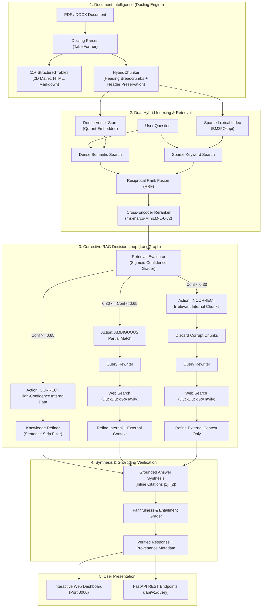
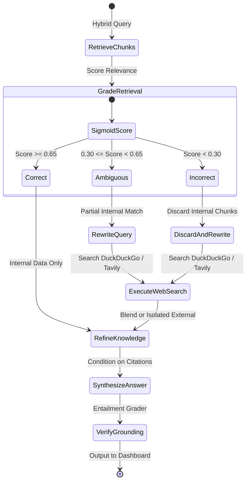

# 🛡️ VeritasCRAG

<div align="center">

[](https://www.python.org/)
[](https://fastapi.tiangolo.com/)
[](https://pytorch.org/)
[](https://github.com/DS4SD/docling)
[](https://github.com/langchain-ai/langgraph)
[](https://qdrant.tech/)
[](https://opensource.org/licenses/MIT)

**Production-Grade Corrective RAG (CRAG) & Document Intelligence System**  
*Extract complex multi-page tables, self-reflect on retrieval quality, gracefully fall back to web search, and eliminate hallucinations with sentence-level entailment verification.*

[Architecture](#-system-architecture) • [Why VeritasCRAG?](#-why-veritascrag-naive-rag-vs-crag) • [Web Dashboard](#-interactive-web-dashboard) • [Quickstart](#-quickstart--developer-guide) • [API Specs](#-rest-api-reference)

</div>

---

## 💡 Executive Summary

Standard RAG (Retrieval-Augmented Generation) pipelines fail catastrophically in enterprise settings when dealing with **financial statements**, **multi-column documents**, or **out-of-domain user questions**. Naive chunking tears tabular matrices apart, and standard LLM generators silently hallucinate when retrieved documents don't contain the answer.

**VeritasCRAG** solves this end-to-end:
1. **IBM Docling Document Engine**: Preserves multi-column layout geometry, reading order, and multi-row tables as structured 2D matrices.
2. **Hybrid Retrieval (Dense + Sparse + Cross-Encoder)**: Merges semantic vectors (Qdrant) and exact keyword matches (BM25Okapi) using **Reciprocal Rank Fusion (RRF)**, reranked by a deep Cross-Encoder.
3. **Corrective RAG (CRAG) Decision Engine**: A self-reflective evaluator grades retrieval confidence. If internal knowledge is insufficient or missing, it dynamically triggers an active web search fallback (DuckDuckGo / Tavily).
4. **Faithfulness & Grounding Verification**: Evaluates generated claims against source citations to prevent hallucinations before the user ever sees an answer.
5. **Full Glassmorphic Web Dashboard**: An interactive visual dashboard with a spreadsheet table viewer, document intelligence navigator, and real-time CRAG confidence inspector.

---

## ⚖️ Why VeritasCRAG? (Naive RAG vs. CRAG)

| Challenge | Naive / Traditional RAG | VeritasCRAG System |
| :--- | :--- | :--- |
| **Complex Tables & Spreadsheets** | Splits tables blindly at character limits ($500$ chars), separating column headers from values and turning data into garbage. | **IBM Docling TableFormer** converts tables into 2D tabular matrices, HTML, and Markdown. `HybridChunker` repeats table headers across rows. |
| **Out-of-Domain Queries** | Retrieves the least irrelevant chunk and forces the LLM to guess, producing plausible hallucinations. | Evaluates confidence via Sigmoid Cross-Encoder. If confidence is low ($< 0.30$), it **actively discards internal context** and executes Web Fallback. |
| **Ambiguous Queries** | Returns incomplete context and generates partially grounded answers. | Detects ambiguous retrieval ($[0.30, 0.65)$), rewrites query, searches the web, and merges both sources. |
| **Exact Identifiers & Acronyms** | Pure dense embeddings often miss exact alphanumeric codes (e.g., SEC accession numbers like `0000002178-23-000036`). | **Hybrid RRF Search** pairs Dense MiniLM embeddings with sparse BM25 token matching, ensuring exact IDs are captured. |
| **Hallucination Detection** | No post-generation check. Whatever the LLM outputs is sent to the user. | **Sentence-Level Grounding Grader** checks every generated sentence against reference citations to ensure strict factual entailment. |

---

## 🏗️ System Architecture



---

## 🔄 Corrective RAG (CRAG) Decision Flow

The core differentiator of VeritasCRAG is its dynamic **Self-Reflective State Machine** built on LangGraph:



---

## 🛠️ Technology Stack & Component Breakdown

Every tool in VeritasCRAG was selected for production efficiency, local execution, and low latency:

| Layer | Component | Technology | Purpose & Architectural Justification |
| :--- | :--- | :--- | :--- |
| **Ingestion** | Document Parser | **IBM Docling 2.x** | Advanced deep-learning layout analysis and TableFormer for complex multi-column documents. |
| **Chunking** | Layout Chunker | **Docling HybridChunker** | Layout-aware chunker that retains heading hierarchy breadcrumbs and repeats table headers across chunks. |
| **Dense Search** | Vector Database | **Qdrant (Embedded)** | Fast, local, zero-dependency vector engine running directly from SQLite/memory with payload metadata filtering. |
| **Sparse Search**| Lexical Engine | **BM25Okapi** | Captures exact technical codes, financial tickers, and SEC accession numbers (`adsh`, `cik`, `sic`). |
| **Fusion** | Hybrid Scoring | **Reciprocal Rank Fusion (RRF)** | Formula: $RRF(d) = \sum \frac{1}{60 + \text{rank}(d)}$. Balances semantic and lexical matches without arbitrary scale bias. |
| **Reranker** | Cross-Attention | **Cross-Encoder MiniLM-L-6-v2** | Computes full cross-attention between question and passage; runs natively on Apple Silicon **MPS** or CUDA. |
| **Evaluator** | Quality Grader | **Sigmoid Confidence Grader** | Normalizes reranker logits into $[0, 1]$ probabilities to classify context into `CORRECT`, `AMBIGUOUS`, or `INCORRECT`. |
| **Web Fallback** | Search Engine | **DuckDuckGo / Tavily** | Zero-config privacy-first active web search fallback when internal retrieval is insufficient. |
| **Orchestration**| State Machine | **LangGraph StateGraph** | Multi-step cyclic execution graph managing state transitions, conditional edges, and error recovery. |
| **Verification** | Entailment Grader | **Faithfulness Grader** | Evaluates claim-level entailment against source snippets to flag or prevent hallucinations. |
| **API Server** | Backend Service | **FastAPI + Uvicorn** | Async REST API with OpenAPI documentation, Swagger UI, and CORS middleware. |
| **Frontend** | Interactive UI | **Vanilla HTML5 / Modern CSS** | Ultra-responsive dark glassmorphic dashboard with live table spreadsheet, chunk explorer, and query console. |

---

## 🖥️ Interactive Web Dashboard

VeritasCRAG includes a built-in dashboard served directly by the backend at `http://localhost:8000/`.

### 1. 💬 Ask & Verify (CRAG Studio)
- Real-time query console with suggested sample prompts.
- **Visual Confidence Badge**: Real-time verdict (`CORRECT` 🟢, `AMBIGUOUS` 🟡, or `INCORRECT` 🔴).
- **Latency & Grounding Meter**: Sub-second execution breakdown and faithfulness scores.
- **Clickable Citations**: Full provenance with source document name, heading path, and page numbers.

### 2. 📄 Extracted Document Intelligence
- **Structured View**: Interactive card layout breaking down the document by its actual headings.
- **Formatted Markdown View**: Rendered clean markdown representation.
- **Raw Text View**: Quick one-click copy of the raw text stream.

### 3. 📊 Extracted Tables (Spreadsheet View)
- Financial PDFs often feature 10+ complex multi-column tables. VeritasCRAG displays each table in a dedicated spreadsheet-like card.
- **Geometry Indicators**: Row and column counts (e.g., `Table #3 — 16 rows × 7 columns`).
- **Page Badges & Sticky Headers**: Scroll horizontally and vertically without losing column labels.

### 4. 🧩 Hybrid Chunks Inspector
- Inspect the exact chunks indexed in Qdrant and BM25.
- Displays heading breadcrumbs (e.g., `3 Organization > 5.1 SUB (Submissions)`), token counts, and chunk types (`table` vs `text`).
- Live keyword search bar to filter chunks in real time.

---

## 📁 Repository Directory Structure

```text
Veritas-CRAG/
├── pyproject.toml                             # Packaging, Ruff, and Pytest configuration
├── requirements.txt                           # Production dependency specifications
├── README.md                                  # Complete architecture & documentation
├── src/veritas_crag/
│   ├── api/
│   │   ├── app.py                             # FastAPI REST endpoints & document loader
│   │   └── static/
│   │       └── index.html                     # Modern glassmorphic Web UI dashboard
│   ├── config/
│   │   └── settings.py                        # Pydantic BaseSettings (M4/MPS options, paths)
│   ├── core/
│   │   ├── logger.py                          # Loguru structured color logger
│   │   └── exceptions.py                      # Custom domain exception classes
│   ├── models/
│   │   ├── document.py                        # DocumentMetadata, DocumentTable, DocumentChunk
│   │   ├── retrieval.py                       # RetrievalResult, HybridSearchResult
│   │   ├── crag.py                            # CRAGAction, DocumentGrade, WebSearchResult
│   │   └── pipeline.py                        # Citation, GroundingEvaluation, GeneratedResponse
│   ├── ingestion/
│   │   ├── parser.py                          # DoclingParser (layout analysis, table extraction)
│   │   └── chunker.py                         # Layout-aware DoclingChunker with breadcrumbs
│   ├── retrieval/
│   │   ├── embeddings.py                      # SentenceTransformerEmbeddings (MPS accelerated)
│   │   ├── vector_store.py                    # QdrantVectorStore (embedded persistent storage)
│   │   ├── bm25.py                            # BM25Index (sparse lexical token matching)
│   │   ├── reranker.py                        # CrossEncoderReranker (deep cross-attention)
│   │   └── hybrid.py                          # HybridRetriever (RRF + CrossEncoder)
│   ├── evaluation/
│   │   ├── grader.py                          # DocumentGrader (sigmoid confidence evaluator)
│   │   ├── query_rewriter.py                  # Query transformation & entity extractor
│   │   ├── web_search.py                      # Active web search fallback (DuckDuckGo/Tavily)
│   │   ├── refiner.py                         # Knowledge decomposition & strip filter
│   │   └── crag_engine.py                     # Master Corrective Decision Loop
│   └── pipeline/
│       ├── generator.py                       # Grounded response generator with citations
│       ├── grounding.py                       # Faithfulness & hallucination verification
│       └── workflow.py                        # LangGraph StateGraph orchestrator
├── tests/                                     # Complete automated test suite
├── scripts/
│   ├── run_parser.py                          # CLI: Ingest & parse PDFs with Docling
│   ├── run_retriever.py                       # CLI: Index & test hybrid search
│   ├── run_crag.py                            # CLI: Evaluate corrective action decisions
│   └── run_pipeline.py                       # CLI: Run LangGraph pipeline & launch server
└── data/
    ├── sample_docs/                           # Input PDFs (sample_report.pdf)
    └── output/                                # Exported Markdown, JSON, and Chunks
```

---

## ⚡ Quickstart & Developer Guide

### 1. Prerequisites
- **Python**: 3.10, 3.11, or 3.12
- **Hardware**: Compatible with macOS (Apple Silicon M1/M2/M3/M4 via `mps`), Linux/Windows (CUDA or CPU).

### 2. Installation

```bash
# Clone the repository
git clone https://github.com/Milind1234/Veritas-CRAG.git
cd Veritas-CRAG

# Create and activate virtual environment
python3 -m venv .venv
source .venv/bin/activate

# Install dependencies in editable mode
pip install -e ".[dev]"
```

### 3. Configure Environment Variables

```bash
cp .env.example .env
```
*(Optional: Add `GEMINI_API_KEY` or `OPENAI_API_KEY` if you want frontier LLM synthesis; VeritasCRAG works fully offline in deterministic mode out of the box).*

### 4. Verify Hardware & Accelerator Setup

Check whether Apple Silicon Metal (`MPS`) acceleration is active:
```bash
python scripts/run_parser.py info
```

---

## 🚀 Running the System

### Option A: Launch Web Dashboard & REST Server (Recommended)
Launch the FastAPI server and open the browser:
```bash
python scripts/run_pipeline.py serve --port 8000
```
- 🌐 **Web Dashboard**: Open [http://localhost:8000](http://localhost:8000)
- 📚 **Swagger API Docs**: Open [http://localhost:8000/docs](http://localhost:8000/docs)

### Option B: Command Line (CLI) Workflows

```bash
# 1. Parse a complex PDF document
python scripts/run_parser.py parse data/sample_docs/sample_report.pdf

# 2. Index chunks into Hybrid Stores (Qdrant + BM25)
python scripts/run_retriever.py index

# 3. Test Hybrid Search with Cross-Encoder scoring
python scripts/run_retriever.py search "What is the Docling parser latency on M4?"

# 4. Test the Corrective RAG Decision Loop
# High-confidence internal query -> Action: [CORRECT]
python scripts/run_crag.py evaluate "What is the Docling latency on M4?"

# External unknown query -> Action: [INCORRECT] + triggers Web Search
python scripts/run_crag.py evaluate "What is the latest stock price of Apple?"

# 5. Run full end-to-end LangGraph pipeline query
python scripts/run_pipeline.py query "What is the Docling latency on M4?"
```

---

## 🌐 REST API Reference

| Method | Endpoint | Description | Sample Payload / Response |
| :--- | :--- | :--- | :--- |
| `GET` | `/` | Serves the interactive Web Dashboard. | Returns HTML5 application. |
| `GET` | `/api/v1/health` | Hardware accelerator and system health check. | `{"status": "healthy", "apple_silicon_mps_available": true}` |
| `GET` | `/api/v1/document/latest`| Retrieves parsed metadata, tables, and chunks of the active document. | Returns `IngestResponse` with 11 tables and 23 chunks. |
| `POST` | `/api/v1/ingest` | Upload a PDF (`multipart/form-data`) for Docling parsing and hybrid indexing. | `file: <document.pdf>` |
| `POST` | `/api/v1/query` | Executes end-to-end Corrective RAG pipeline via LangGraph. | `{"query": "What is the adsh field?", "top_k": 5}` |

---

## 🧪 Automated Testing

VeritasCRAG includes a test suite covering document parsing, chunking geometry, hybrid retrieval, CRAG evaluator logic, and LangGraph pipeline orchestration:

```bash
pytest -v
```

> **Note on Concurrency**: VeritasCRAG uses local embedded Qdrant with file locking (`portalocker`). When running the test suite, ensure the background dev server is stopped so both processes do not lock the SQLite store simultaneously.

---

## 📜 License

This project is licensed under the **MIT License** — feel free to use, modify, and distribute it for enterprise and academic applications.
