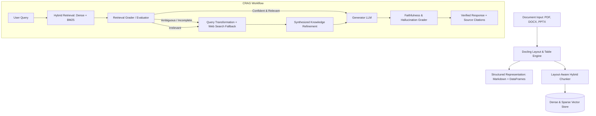

# VeritasCRAG 🛡️
> **Production-Grade Corrective RAG & Document Intelligence System**  
> Optimized for Apple Silicon (M4 / MPS) & Enterprise Workloads.

VeritasCRAG combines state-of-the-art document layout analysis, structured table parsing, corrective retrieval evaluators, and autonomous web fallback verification to eliminate hallucinations in Retrieval-Augmented Generation.

---

## 🏗️ Architecture Overview



---

## 🚀 Phase 1 Features: Document Intelligence & Parsing

- **Docling 2.x Integration**: IBM Docling document converter engine preserving reading order, headers, lists, and complex multi-column layouts.
- **Table Structure Extraction**: Extracts tabular data cleanly into Markdown, HTML, and structured tabular arrays.
- **Apple Silicon M4 Acceleration**: Native PyTorch `MPS` (Metal Performance Shaders) support for layout analysis and embedding inference.
- **Layout-Aware Hybrid Chunking**: Preserves heading hierarchy breadcrumbs (`headings`), table structure continuity, and page provenance for every chunk.
- **Interactive CLI & Telemetry**: Rich terminal interface (`scripts/run_parser.py`) with execution timing, previews, and artifact export.

---

## 📂 Project Structure

```
Veritas-CRAG/
├── .env.example                 # Configuration template
├── .gitignore                   # Git exclusions
├── pyproject.toml               # Modern build configuration and tool options
├── requirements.txt             # Core dependency list
├── requirements-lock.txt        # Frozen reproducible dependencies
├── README.md                    # Project documentation
├── config/                      # Global configuration proxies
├── src/
│   └── veritas_crag/
│       ├── __init__.py
│       ├── config/              # Pydantic BaseSettings management
│       │   ├── __init__.py
│       │   └── settings.py
│       ├── core/                # Core infrastructure (logger, exceptions)
│       │   ├── __init__.py
│       │   ├── logger.py
│       │   └── exceptions.py
│       ├── models/              # Pydantic data models
│       │   ├── __init__.py
│       │   └── document.py      # ParsedDocument, DocumentChunk, DocumentTable
│       ├── ingestion/           # Document ingestion & parsing
│       │   ├── __init__.py
│       │   ├── parser.py        # DoclingParser engine
│       │   └── chunker.py       # Layout-aware DoclingChunker
│       ├── retrieval/           # Phase 2: Hybrid vector store & embeddings
│       ├── evaluation/          # Phase 3: Corrective graders & evaluators
│       └── pipeline/            # Phase 4: LangGraph CRAG orchestrator
├── tests/                       # Pytest automated test suite
│   ├── conftest.py
│   ├── test_models.py
│   ├── test_parser.py
│   └── test_chunker.py
├── data/
│   ├── sample_docs/             # Input documents directory
│   └── output/                  # Output parsed JSON, MD, and chunks
└── scripts/
    └── run_parser.py            # CLI entry point
```

---

## ⚡ Quickstart & Setup

### 1. Environment Setup
The project uses **Python 3.11** with Apple Silicon M4 optimizations:

```bash
# Clone and enter directory
cd /Users/milind/Veritas-CRAG

# Activate virtual environment
source .venv/bin/activate

# Install in editable mode with development dependencies
pip install -e ".[dev]"
```

### 2. Verify Hardware & System Status
Check PyTorch Apple Silicon MPS acceleration and Docling status:

```bash
python scripts/run_parser.py info
```

---

## 🛠️ Usage Guide

### CLI Ingestion & Parsing
Parse any PDF document and export Markdown, structured JSON, and chunks to `data/output/`:

```bash
python scripts/run_parser.py parse data/sample_docs/sample_report.pdf
```

Options:
- `--ocr / --no-ocr`: Enable/disable OCR (disabled by default for native digital PDFs).
- `--tables / --no-tables`: Extract detailed table structures (enabled by default).
- `--device [auto|mps|cpu]`: Hardware accelerator (defaults to `auto` with MPS on Apple Silicon).
- `--output-dir PATH`: Custom output directory.
- `--chunk / --no-chunk`: Toggle layout-aware chunk generation.

### Python API Example

```python
from pathlib import Path
from veritas_crag.ingestion.parser import DoclingParser

# 1. Initialize Parser
parser = DoclingParser(enable_ocr=False, enable_table_structure=True)

# 2. Parse Document
parsed_doc = parser.parse(Path("data/sample_docs/sample_report.pdf"), chunk=True)

# 3. Access Metadata & Content
print(f"Parsed {parsed_doc.metadata.file_name} in {parsed_doc.metadata.parsing_duration_seconds}s")
print(f"Extracted {parsed_doc.total_tables} tables and {parsed_doc.total_chunks} chunks.")

# 4. Inspect Layout-Aware Chunks
for chunk in parsed_doc.chunks:
    print(f"[{chunk.chunk_id}] Headings: {chunk.headings} | Type: {chunk.chunk_type}")
    print(f"Pages: {chunk.page_numbers}\nText:\n{chunk.text}\n")

# 5. Export artifacts to disk
parser.export_to_disk(parsed_doc, output_dir="data/output")
```

---

## 🧪 Running Tests

Run the comprehensive unit and integration test suite:

```bash
pytest -v
```

---

## 🗺️ Roadmap

- [x] **Phase 1: Foundation & Document Intelligence**
  - Python 3.11 virtual environment & dependencies
  - Modular project architecture & configuration
  - Docling 2.x layout analysis, table extraction, and MPS acceleration
  - Layout-aware hybrid chunking & rich CLI
- [ ] **Phase 2: Hybrid Indexing & Storage**
  - Vector embeddings (local MPS / remote)
  - Hybrid search (Qdrant + BM25)
  - Reranker cross-encoder integration
- [ ] **Phase 3: Corrective Retrieval & Evaluation (CRAG)**
  - Document relevance grading & confidence thresholding
  - Active web search corrective fallback loop (Tavily)
  - Query transformation & refinement
- [ ] **Phase 4: Synthesis, Grounding & LangGraph Orchestration**
  - Hallucination and faithfulness evaluator
  - LangGraph state machine orchestrator
  - FastAPI serving & stream response UI
